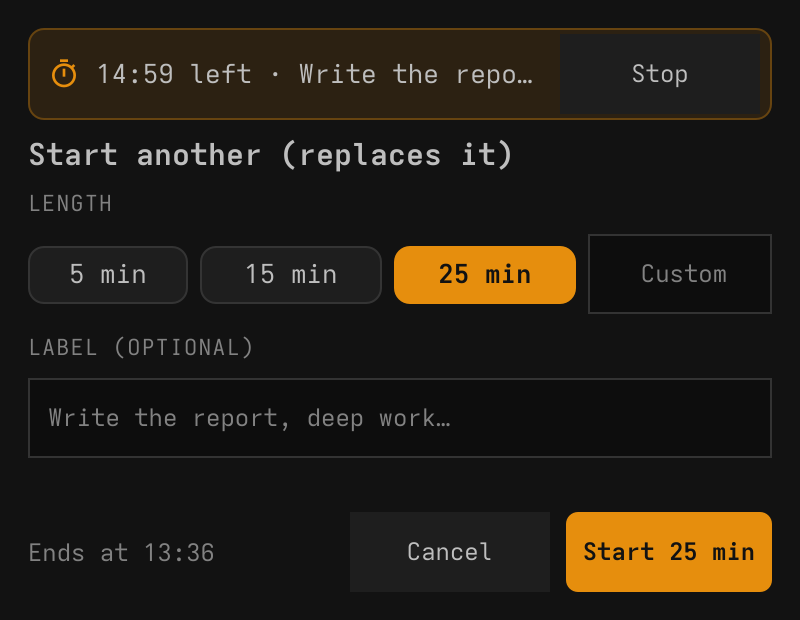
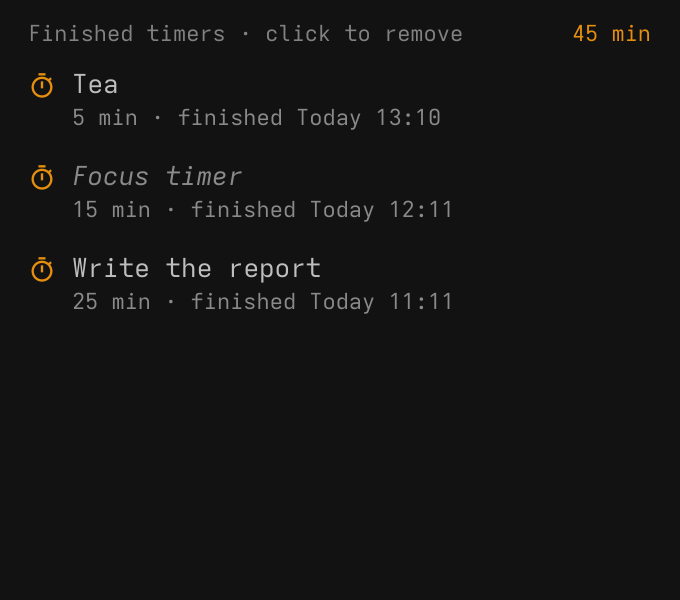

# Focus timer for SUPER DESKTOP

A countdown timer in the [SUPER DESKTOP](https://github.com/gladimdim/super-desktop)
top bar. Click it to start one, right-click it for the timers you finished.
When time is up you get a notification and an alarm sound, and the button
flashes until you click it.

| Running | Done | Start (click) | History (right-click) |
| --- | --- | --- | --- |
|  |  |  |  |

## Use it

- **Click the button** to start a timer: 5, 15 or 25 minutes, or type your
  own length (`40`, `7.5`, or `1:30` for an hour and a half), add a label if
  you like, and press **Start** or Enter. The length you used last is picked
  next time.
- **While it runs** the button shows the time left and a progress line.
  Click it again to see it with a **Stop** button, or to start another one
  (it replaces the running timer).
- **When it ends** you get a desktop notification and the alarm sound, and
  the button flashes "Done!" until you click it.
- **Right-click the button** for your finished timers, newest first, with the
  total time. Click one to remove it.

The timer keeps going while SUPER DESKTOP is hidden. One that ended while
SUPER DESKTOP was not running is added to the history when it starts, without
the sound if that was more than five minutes ago. Colors come from your
Omarchy theme and stay readable in light and dark themes.

## Install

Needs SUPER DESKTOP 1.6.0 or newer (popups and button tooltips).

```sh
super-desktop plugin install https://github.com/gladimdim/super-desktop-focus-timer
super-desktop plugin approve focus-timer
```

Or approve it in Settings → Plugins, where **Ask AI to review** reads it first.

## What it does on your PC

- Saves the running timer and the history in SUPER DESKTOP's plugin values
  (`~/.local/state/super-desktop/plugins/focus-timer.data.json`).
- Shows notifications through SUPER DESKTOP (`notify-send`).
- Plays `alarm-clock-elapsed.oga` from the freedesktop sound theme
  (`sound-theme-freedesktop`) with `pw-play`, else `paplay`, else `aplay`.
- Nothing else: no network, no other files, no other programs.

## Change it

It is plain QML: edit a file and SUPER DESKTOP reloads it. `AGENTS.md`
describes how it works for an AI agent; `super-desktop plugin check
focus-timer` and `super-desktop plugin snapshot focus-timer --surface start`
check your edits.

It was written by an AI agent from SUPER DESKTOP's plugin skill alone, as a
test of how far the skill gets a new agent.

## License

MIT
